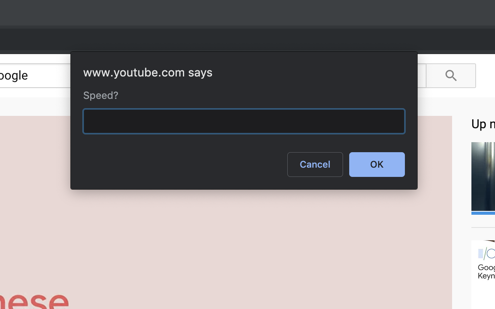

# Custom-Playback-Speed
Chrome extension that allows you to set the playback speed of any video in your browser to whatever you want.



Click the toolbar button, type a speed (for example `1.75`, `2,5` or `3x`), and every video on the page switches to it. The prompt starts with the current speed. Chrome allows speeds from 0.0625 to 16.

Shortcut: **Alt+Shift+S** (change it at `chrome://extensions/shortcuts`). On pages where Chrome doesn't let extensions run (like `chrome://` pages, the Chrome Web Store and the New Tab page), the button shows a red **!** and its tooltip explains why.

[Chrome Webstore Link](https://chrome.google.com/webstore/detail/custom-playback-speed/giolnpkidakdmghddhlikfjbakcgejld)

## Install from source
1. Download or clone this repo.
2. Open `chrome://extensions` and turn on **Developer mode**.
3. Click **Load unpacked** and choose this folder.

Uses Manifest V3 (`activeTab` + `scripting`), so it only touches the tab you click it on.

## Bookmarklet
Or, get it in bookmarklet form. Just paste the following into the "URL" section of a chrome bookmark link:

```
javascript:(function(){var v=[].slice.call(document.querySelectorAll('video'));if(!v.length){alert('No video found on this page.');return}var x=prompt('Speed? (0.0625 to 16)',String(v[0].playbackRate));if(x===null||x.trim()==='')return;var s=parseFloat(x.trim().replace(',','.').replace(/x$/i,''));if(!isFinite(s)||s<0.0625||s>16){alert('Please enter a number from 0.0625 to 16.');return}v.forEach(function(e){e.playbackRate=s})})();
```

## Tests
```sh
node --test test/*.test.js
```
